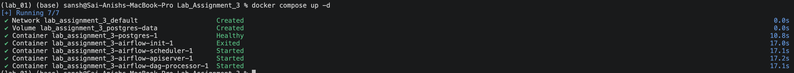
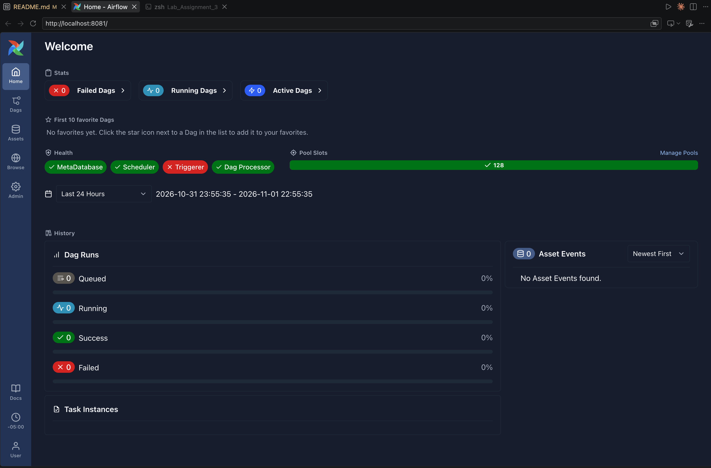
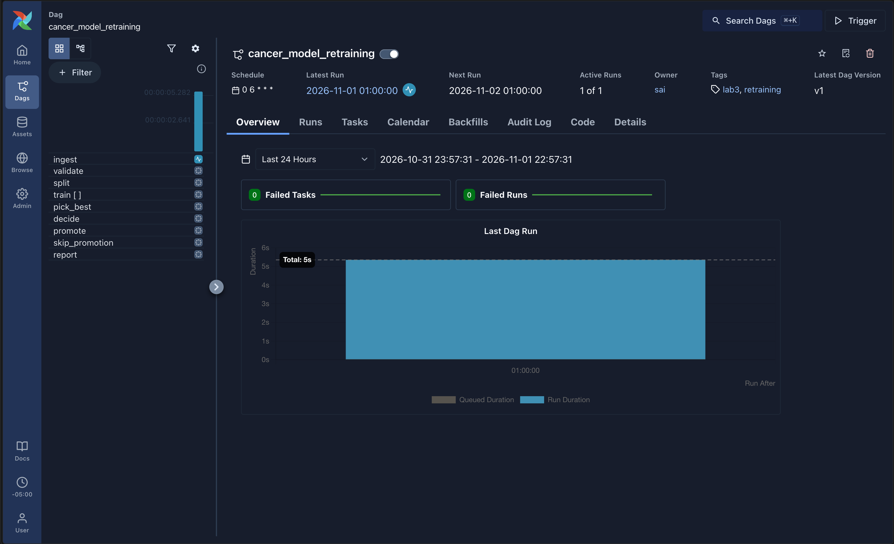
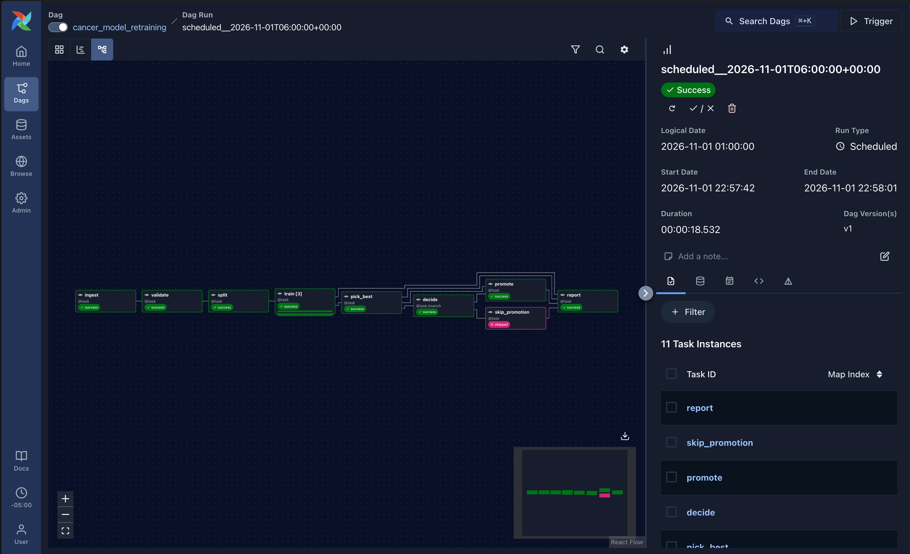
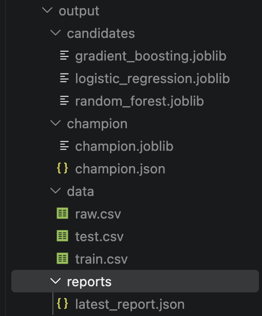
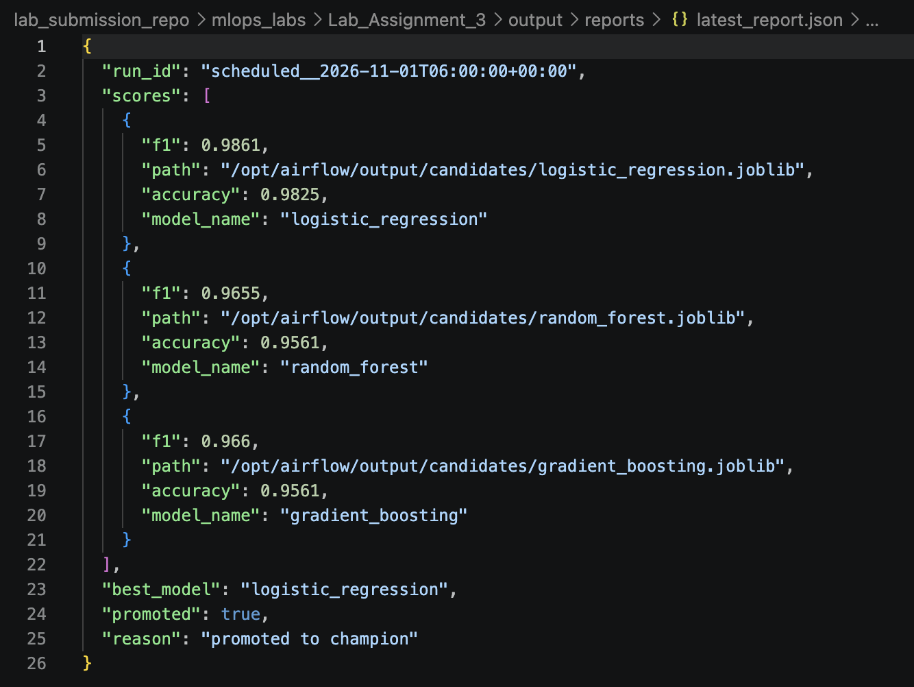

# Lab Assignment 3 - Cancer Model Retraining Pipeline (Airflow Labs - Lab 1)

Airflow runs a pipeline every day. The pipeline trains 3 models at the same time, picks the best one, and keeps it **only if it is good enough and better than the model we already have**.

## Original lab and what I changed

Original lab: [Airflow Labs - Lab 1](https://github.com/raminmohammadi/MLOps/tree/main/Labs/Airflow_Labs/Lab_1)

| Part | Original | Mine |
|---|---|---|
| Problem | K-Means clustering on credit card data | Retrain and promote a cancer classifier |
| Data | 8,950-row CSV file | Built-in scikit-learn dataset, no CSV |
| DAG | 4 tasks in a straight line, manual trigger | 9 tasks with parallel training, a branch, daily schedule, run settings and retries |
| Code | `PythonOperator` and `lab.py` | TaskFlow (`@dag`, `@task`) and plain steps in `pipeline.py` |
| Airflow config | 3,198-line `airflow.cfg`, `docker-compose.yaml` downloaded by hand | 9-line `airflow.cfg`, own `docker-compose.yaml` and `Dockerfile` |
| Output | Model saved inside the code folder | `output/` folder with data, models, champion and report |

## What I built

- **Data:** Breast cancer dataset from scikit-learn (569 patients, 30 numbers each). Comes with scikit-learn, no download needed.
- **Models:** Logistic Regression, Random Forest, Gradient Boosting. All 3 train in parallel.
- **Score:** f1 score on test data. Highest f1 wins.
- **Champion:** The model we keep. A new model replaces it only if:
  1. its f1 is at least `min_f1` (default 0.95), and
  2. its f1 is higher than the current champion.
- **Airflow:** Runs in Docker. Postgres database, LocalExecutor, no example DAGs.

## How the pipeline flows

```
ingest -> validate -> split -> train x3 (parallel) -> pick_best -> decide --+--> promote ------+--> report
                                                                            |                  |
                                                                            +--> skip_promotion+
```

| Task | What it do |
|---|---|
| `ingest` | Save data as `raw.csv` |
| `validate` | Fail if too few rows, missing values, or one class only |
| `split` | Make `train.csv` and `test.csv` |
| `train` | Train one model. Airflow makes 3 copies, one per model |
| `pick_best` | Pick model with highest f1 |
| `decide` | Branch: go to `promote` or `skip_promotion` |
| `promote` | Copy best model to `output/champion/` |
| `skip_promotion` | Do nothing, champion stays |
| `report` | Write `output/reports/latest_report.json` |

Other things in the DAG:
- Runs every day at 06:00 UTC (`0 6 * * *`). You can also trigger by hand.
- Each task retries 1 time after 1 minute if it fails.
- 3 settings you can change on each run (see below).

## Files

```
Lab_Assignment_3/
├── dags/
│   ├── cancer_retraining_dag.py   the Airflow DAG (task order)
│   └── src/
│       ├── __init__.py
│       └── pipeline.py            plain Python steps (no Airflow code)
├── config/
│   └── airflow.cfg                our Airflow settings
├── docker-compose.yaml            starts Postgres + Airflow
├── Dockerfile                     Airflow image + our packages
├── requirements.txt               scikit-learn, pandas, joblib
├── setup.sh                       one-time setup
└── README.md
```

Made when you run it (not saved in git): `output/` (data, models, report), `logs/`, `.env`.

## Airflow settings

Settings live in two places:

- `config/airflow.cfg` (only what we change):
  - `executor = LocalExecutor` - tasks run on same machine
  - `load_examples = False` - no demo DAGs
  - `dags_are_paused_at_creation = True` - new DAG starts paused
  - `parallelism = 8`, `max_active_tasks_per_dag = 4` - how many tasks at once
  - `max_active_runs_per_dag = 1` - one run at a time
- `docker-compose.yaml` (secrets and connections):
  - Postgres database
  - No login screen (`SIMPLE_AUTH_MANAGER_ALL_ADMINS`). **Local lab only. Do not use like this for real.**
  - Output folder `/opt/airflow/output`

## Setup (do one time)

You need **Docker Desktop** running. Give it at least 4 GB memory.

Open terminal inside the `Lab_Assignment_3` folder.

1. Run setup:
   ```
   bash setup.sh
   ```
2. Build the image:
   ```
   docker compose build
   ```

**Port 8080 busy?** Pick another one before starting:
```
echo "AIRFLOW_PORT=8081" >> .env
```
Then use 8081 instead of 8080 everywhere below.

## Run it

1. Start Airflow:
   ```
   docker compose up -d
   ```
   Wait about 1 minute. You should see all containers `Started` or `Healthy`:

   

2. Open http://localhost:8080 (with the correct port number) in browser. No password needed.

   

3. Find DAG **cancer_model_retraining**. Flip the switch to turn it on (it starts paused).
4. Click the play button -> **Trigger**. A box shows the 3 settings. Change them or just press **Trigger**. The tasks start running:

   

5. Click the run to watch tasks turn green. Use the **Graph** tab to see the branch. Here `promote` ran, so `skip_promotion` is pink (skipped):

   

6. See the results in the `output/` folder on your machine:
   - `output/reports/latest_report.json` - scores, best model, promoted yes/no, and why
   - `output/champion/champion.joblib` - the model we keep
   - `output/champion/champion.json` - champion scores
   - `output/candidates/` - all 3 trained models

   

   This is `latest_report.json`:

   

Stop Airflow:
```
docker compose down
```
Start from zero (delete database too): `docker compose down -v`

## Settings you can change on each run

| Name | Default | What it do |
|---|---|---|
| `min_rows` | 500 | `validate` fails if data has fewer rows |
| `test_size` | 0.2 | Share of data kept for testing |
| `min_f1` | 0.95 | Best model needs at least this f1 to be promoted |

## Try these to see it work

- **First run:** no champion yet, so best model is promoted. Report says `promoted: true`.
- **Run again:** same data, same score, does not beat champion. `skip_promotion` runs. Report says `does not beat champion`.
- **Set `min_f1` to 0.999:** score too low. `skip_promotion` runs. Report says `below the minimum`.
- **Set `min_rows` to 1000:** data only has 569 rows. `validate` fails, retries once, then all tasks after it stop. Nothing is promoted.

## Good to know

- Tasks pass only small things (file paths and scores) to each other. Big data stays in csv files.
- To start fresh, delete the `output/` folder.
- DAG not showing? Wait 30 seconds and refresh. To see errors: `docker compose exec airflow-scheduler airflow dags list-import-errors`
- Tasks log to the Airflow page (click task -> **Logs**).
